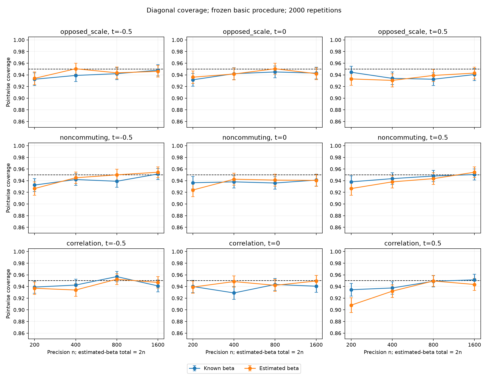
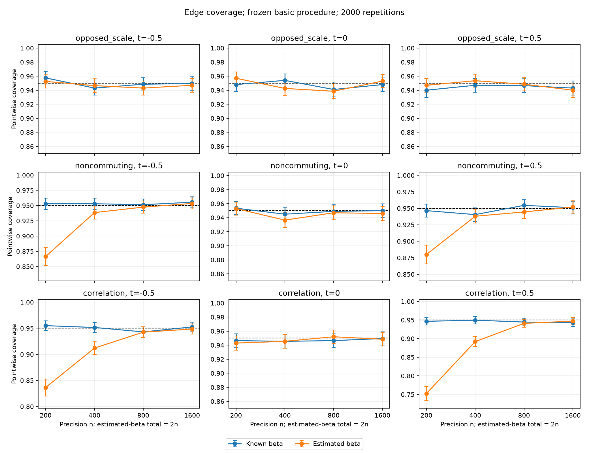

# Pointwise coverage after feasible index estimation

## Scope

Compare known beta with independently estimated beta using the **basic**
refitted square-root Lasso estimator. No correction is enabled in this primary
comparison. No support gate, penalty CV, bootstrap, or uniform band is used.
Failures count as noncoverage; conditional coverage is also reported.

The approved designs are opposed scale (amplitude 0.6), noncommuting (0.6), and
correlation (0.55), with 40 responses and 20 covariates. Precision sample sizes
are 200, 400, 800, and 1600. Index training initially uses the same sample size,
independently, so estimated-index total sample size is twice the precision n.
The known-index comparator uses the identical precision observations.

## Index estimation

Opposed scale uses the mixed probe bank: all 40 squares, 30 random products,
and 30 squared random projections. The other designs use all 820 quadratic
products including squares. Probe randomness is independent of observations
and truth. Center and standardize probes, regress them on the 20 covariates,
rank covariates by OLS coefficient row norms, retain 10, and refit without
penalty. Aggregate by the rank-one reduced-rank regression direction. An
unscreened 20-covariate sensitivity is reserved for the paired stage.

Orientation uses the fixed external reference vector with entries 1/j. It
never uses true beta or a fixed nonzero first coordinate. Record orientation
errors; never discard them. The primary evaluation point is zero, which is
sign invariant; secondary points are -0.5 and 0.5. The DGP beta has entries
(1,1,-1,-1)/2 on coordinates 2:5 and zero elsewhere.

Training and precision samples have independent response permutations. The
worker aligns training response columns with the precision sample's response
labels before fitting. This preserves the shared observable response identities.
Targets are selected by canonical graph role and mapped through the precision
sample permutation, solely to identify prespecified evaluation entries.

## Precision inference

Use singleton residualization for diagonals and common-complement two-response
residualization for off-diagonals. Positive pilot-kernel weights define weighted
square-root Lasso; refit each selected support by weighted least squares.
Use a degree-two local polynomial on residual products, invert its intercept,
and use HC0 normal intervals. Residual degrees-of-freedom, HC3, and inverse-bias
corrections are all disabled. Singular refits are failures, without ridge repair.

The fixed normal-score penalty uses tail probability 0.1 per regression and
C in {0.75,1.1,1.25}. Its predictor score scale uses squared kernel weights;
no CV is performed. Final bandwidth is hfactor*n^(-1/5), with hfactor in
{1,1.5,2}; pilot bandwidth ratios are {1,2,3}. Units are the unit-variance index.

## Stages and retention

1. Canary: two paired replications at n=200 and 800 in each family, all 27
   tuning combinations, to exercise targets, orientation, and numerical failures.
2. Known-index development: 300 replications, all 12 design/sample-size settings,
   all 27 tuning combinations. This calibrates precision inference independently
   of index error.
3. Freeze a small set using known-index development only. Compare known and
   estimated directions on matched precision samples, then confirm frozen basic
   specifications with 2000 independent replications. Confirmatory seeds are
   disjoint from development. Include unscreened-index and doubled-training
   sensitivities on selected settings.
4. If known-index coverage is poor, investigate corrections in separate arms:
   degrees of freedom only, HC3 only, and inverse-bias only. Keep the basic arm
   as reference. Do not replace the primary procedure silently.

Report each entry and point separately: unconditional/conditional coverage,
availability, interval length, bias, empirical SD, RMS standard error,
studentized error mean/SD, index error, orientation errors, local effective
sample size, and selected nuisance support size. Training uncertainty is not
included automatically in HC0: the experiment tests that approximation.

Numerical workers and summaries run under Slurm on Discovery. Retain bounded
raw CSV shards there, and compact summary/failure tables, receipts, source
snapshot hash, settings, and job identifiers in the run record. No manuscript
or precision-band claim is changed by this experiment.

### Frozen development selection rule

Keep the fixed reference C=1.1, final factor=1.5, pilot ratio=2. Also select the
configuration minimizing mean absolute known-beta coverage error from 0.95,
plus twice mean failure rate, with equal weight on all entry/point/n cells.
If this equals the reference, retain the next-ranked configuration as the
second choice. This is simulation-based development calibration, not a general
data-driven bandwidth selector. Preserve the full grid, including adverse cells.

Trigger the separate known-beta correction experiment if the development-best
specification has coverage below 0.925 or availability below 0.99 in any cell
with n>=400. This is an exploratory trigger, not a multiple-testing claim.
Corrections are tested separately; the 2000-replication confirmation still
uses the frozen basic procedure, regardless of correction results.

The allocation pipeline runs grid, paired development, triggered separate
corrections, basic confirmation, and doubled-training sensitivity. The paired
stage includes the all-20-covariate index fit. Seeds differ by stage; no
estimated-index coverage influences the frozen tuning choices.

### Recreation

Use the existing Discovery Julia 1.13.2 Manifest and depot recorded in the run
registry. Generate plans with `python3 experiments/single_index/promising_coverage_plans.py`.
Submit `promising_coverage.sbatch canary_fixed` with a one-node, 12-worker
allocation. After its receipt validates, submit
`sbatch experiments/single_index/promising_coverage_pipeline.sbatch`.
Both commands run from the staged project root. The pipeline uses 64 single-CPU
workers across four nodes, 32 GB per node, and a four-hour wall limit. BLAS and
Julia are single-threaded. No computation runs on the login node.

The initial canary failed on a reporting-field typo (`failure` versus
`failures`). It finalized no shards. The repaired canary passed 30 checks and
all 7776 expected coverage records, with zero failed fits. Its two repetitions
per setting validate execution only; they are not coverage evidence. Production
moves training seeds to a separate +10^10 namespace and repeats the design/index
checks before fitting, avoiding any development/confirmation sample reuse.

The degrees-of-freedom arm uses the existing common-union weighted refit and
residual-maker variance factor. Thus, for a two-response block, it also places
both response regressions on the union of their selected supports; it is not
merely multiplication by a scalar n/(n-k). The HC3 arm adjusts the final local
polynomial score by its smoothing leverage. It does not implement a separate
nuisance-regression HC3 correction. These distinctions matter when interpreting
any improvement.

### Frozen basic specifications

Known-beta development selected the following configurations. Each is compared
with the prespecified reference C=1.1, final factor=1.5, pilot ratio=2.

| Design | C | Final h / n^(-1/5) | Pilot h / final h |
| --- | ---: | ---: | ---: |
| Opposed scale | 0.75 | 1 | 3 |
| Noncommuting | 0.75 | 2 | 2 |
| Correlation | 0.75 | 1.5 | 3 |

These choices are fixed before independent confirmation. They are not claimed
as universal constants. The full 27-configuration development grid remains
available, rather than reporting only its selected configurations.

### Interpreting the central point

For the correlation design, the conditional covariance is affine in tanh(t),
with constant unit diagonals. Given any normalized estimated direction,
T conditional on its index being zero is a centered Gaussian. Its expected
tanh(T) is therefore zero. Consequently the population conditional covariance
at zero equals Sigma(0), even with an inaccurate direction. Central coverage
alone does not validate index estimation in this family. Nonzero-point results
are essential and are plotted separately for diagonal and off-diagonal targets.
The other two families have nonlinear covariance curves and do not have this
same cancellation of the full conditional covariance.

## Completed results

All numerical work ran on Discovery. The main allocation (13446616) completed
in 11 minutes 40 seconds. Reporting jobs 13446763, 13446932, and 13447027
completed. The main receipts validate 1,166,400 grid records, 259,200 paired
records, 172,800 separate-correction records, 1,152,000 confirmation records,
and 86,400 doubled-training records. Identities are unique and coverage was
recomputed from estimates and standard errors. There were 11 grid failures,
zero paired/correction/sensitivity failures, and six confirmation failures.
Every failure remains in the coverage denominator. The confirmation failures
were nonpositive final residual covariance blocks in opposed scale at n=200,
t=-0.5. They do not explain the correlation-family coverage deficits.

### Off-diagonal confirmation

The following are percentages for the selected varying edge at t=0.5. Each
cell is **known beta / estimated beta**, based on 2000 paired replications.
The estimated-index method uses n additional independent training observations;
its total sample size is 2n. Monte Carlo standard error near 95% is about
0.49 percentage points. Paired differences have their own MCSE in the tables.

| Design | n=200 | n=400 | n=800 | n=1600 |
| --- | ---: | ---: | ---: | ---: |
| Opposed scale | 94.00 / 94.70 | 94.70 / 95.35 | 94.65 / 94.85 | 94.30 / 94.00 |
| Noncommuting | 94.65 / 88.00 | 94.05 / 93.80 | 95.45 / 94.45 | 95.10 / 95.20 |
| Correlation | 94.65 / 75.25 | 94.95 / 89.20 | 94.45 / 94.10 | 94.30 / 94.70 |

Opposed scale is relatively insensitive to replacing beta by its estimate.
Noncommuting has a clear deficit at n=200 but little additional deficit by
n=400. Correlation remains problematic at n=400; its coverage approaches the
known-beta comparator by n=800. This is a setting-specific transition, not a
universal sample-size threshold. At n=400 the correlation edge coverage
change is -5.75 percentage points, with paired MCSE 0.80 points; at n=800
it is -0.35 points, with MCSE 0.59 points.

### Diagonals and separate corrections

Diagonal undercoverage is not solely an index-estimation issue. For the
opposed-scale increasing-variance block at t=0.5, known/estimated coverage
is 93.40/93.05% at n=400 and 93.25/93.90% at n=800. Its inverse covariance
estimate has positive finite-sample bias even with known beta. The
noncommuting constant-diagonal control is closer to 95% at larger n.
The correlation diagonal at t=0.5 improves from 93.45/90.80% at n=200 to
94.90/94.95% at n=800.

The separate 300-replication correction experiment found substantial reductions
in central diagonal bias from the inverse-bias correction, but mixed coverage
changes. For example, opposed scale at n=400,t=0 has basic bias 0.1443 versus
0.0748 after inverse correction; both have coverage 95.33% in that diagnostic
sample. At n=200 its bias falls from 0.2489 to 0.1203, while coverage changes
from 94.00% to 93.67%. HC3 widens intervals modestly; degrees-of-freedom
adjustment changes bias less. These diagnostics do not establish a universal
correction. None was substituted into primary confirmation.

### Direction error versus orientation

The mean squared-sine index errors at n=200 are 0.0404, 0.1383, and 0.5223
for opposed scale, noncommuting, and correlation. Corresponding orientation
error rates under the fixed 1/j reference are 0.45%, 8.75%, and 27.05%.
At n=400 correlation has direction error 0.0882 and orientation error 4.70%;
at n=800 these become 0.0152 and zero observed orientation errors.

An explicitly infeasible diagnostic separates orientation from other index
error. If the estimated direction has negative inner product with true beta,
swap the already computed fits at positive and negative evaluation points.
Do not refit, change the primary results, or call this a feasible procedure.
At t=0.5 this changes n=200 noncommuting coverage from 88.00% to 93.90%:
orientation explains most of that deficit. Correlation changes from 75.25%
to 84.45%, so substantial difficulty remains even with the true sign. At
n=400 correlation changes from 89.20% to 92.85%. These findings distinguish
a weak orientation convention from angular estimation error.

The all-20-covariate RRR sensitivity is sometimes better at n=200; screening
to ten is not uniformly preferable. In the independent 300-replication
correlation sensitivity at precision n=400 and training n=800, edge coverage
is 94.00% and mean direction error is 0.0158. This supports further study
of training allocation; it is not the 2000-replication confirmation and uses
a total of 1200 observations.

### Reporting inputs

[Compact summaries and paired contrasts](../../experiments/single_index/results/promising_coverage/reporting/)
include every requested target and point, the baseline specification, the
frozen development choices, the correction diagnostics, interval lengths,
standard-error diagnostics, and first-stage errors. Complete plans and stage
receipts are retained with them. Raw CSV shards remain in the Discovery run
directory recorded in the project registry.

For reporting recreation, submit `promising_coverage_final.sbatch` after the
pipeline succeeds. Then submit `promising_coverage_diagnostics.sbatch` after
that reporting job succeeds. The latter reproduces the interpretation and
explicitly infeasible orientation diagnostic from saved shards, without
refitting. All three reporting figures were visually inspected. Python and
shell syntax checks also passed. No package estimator behavior was changed
by this campaign.
